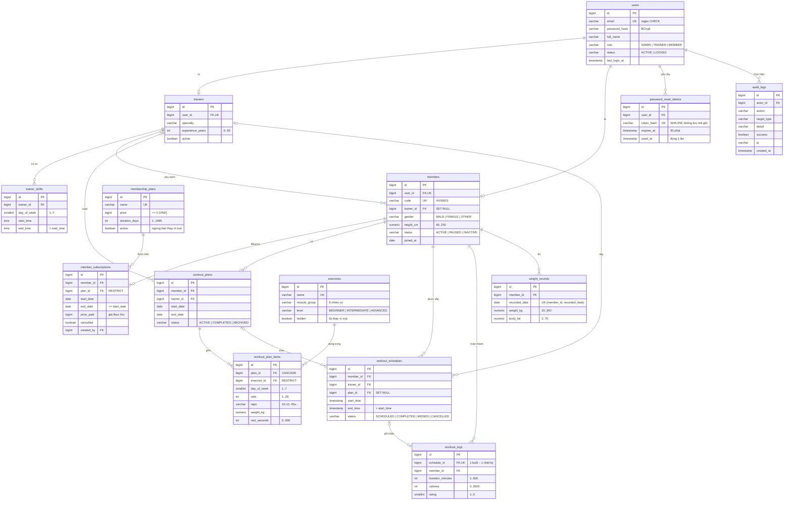

# GymFlow – Thiết kế cơ sở dữ liệu

Lược đồ do **Flyway** quản lý (`backend/src/main/resources/db/migration/V1__init_schema.sql`), Hibernate chỉ đọc (`ddl-auto: none`).
Nguyên tắc: **mọi quy tắc toàn vẹn quan trọng đều nằm ở CSDL**, kể cả khi service đã kiểm tra trước, để không có đường nào ghi được dữ liệu sai.

## Sơ đồ ERD

## Ràng buộc nghiệp vụ đặt trong CSDL

| Quy tắc | Cài đặt | Tên ràng buộc |
| --- | --- | --- |
| Một hội viên không có 2 gói chồng thời gian (trừ gói đã huỷ) | MySQL không có `EXCLUDE` → `SubscriptionService.create`: khoá dòng hội viên (`SELECT … FOR UPDATE`) rồi `existsOverlap` | (service, HTTP 409) |
| HLV không dạy 2 buổi trùng giờ | `ScheduleService`: khoá dòng hội viên rồi HLV, sau đó `trainerBusy` (bỏ qua buổi đã huỷ) | (service, HTTP 409) |
| Hội viên không có 2 buổi trùng giờ | như trên với `memberBusy` | (service, HTTP 409) |
| Mỗi ngày tối đa 1 bản ghi cân nặng | `UNIQUE (member_id, recorded_date)` | `uq_weight_member_day` |
| Mỗi buổi tập chỉ ghi nhận hoàn thành 1 lần | `UNIQUE (schedule_id)` | `uq_logs_schedule` |
| Gói đã bán / bài tập đã dùng không bị xoá cứng | `ON DELETE RESTRICT` | FK `plan_id`, `exercise_id` |
| Giờ/ngày, phạm vi số (cân nặng, % mỡ, số hiệp, đánh giá…) | `CHECK` | `ck_*` |

Ứng dụng chạy ở mức cô lập READ COMMITTED (`application.yml`) để sau khi chờ khoá, câu kiểm tra trùng thấy ngay dữ liệu vừa commit. CSDL: MySQL 8.4, InnoDB, `utf8mb4`; cột tên gói/bài tập dùng `utf8mb4_0900_as_ci` để phân biệt có dấu – không dấu.

`GlobalExceptionHandler` ánh xạ tên ràng buộc → thông báo tiếng Việt (HTTP 409/400), nên dù có request đi vòng qua service, người dùng vẫn nhận lỗi dễ hiểu.

## Trạng thái gói tập

Không lưu cột trạng thái, tính theo ngày hôm nay (`MemberSubscription.stateOn`, view `v_subscription_status` cho báo cáo SQL):

| Điều kiện | Trạng thái |
| --- | --- |
| `cancelled = true` | Đã huỷ |
| hôm nay < `start_date` | Sắp bắt đầu |
| hôm nay > `end_date` | Hết hạn |
| còn ≤ 7 ngày | Sắp hết hạn |
| còn lại | Còn hiệu lực |

## Index chính

`ix_sub_member (member_id, end_date)`, partial `ix_sub_end … WHERE NOT cancelled`, `ix_ws_member_time`, `ix_ws_trainer_time`, `ix_ws_status_time` (job tự đánh vắng), `ix_logs_member`, `ix_audit_created DESC`.
