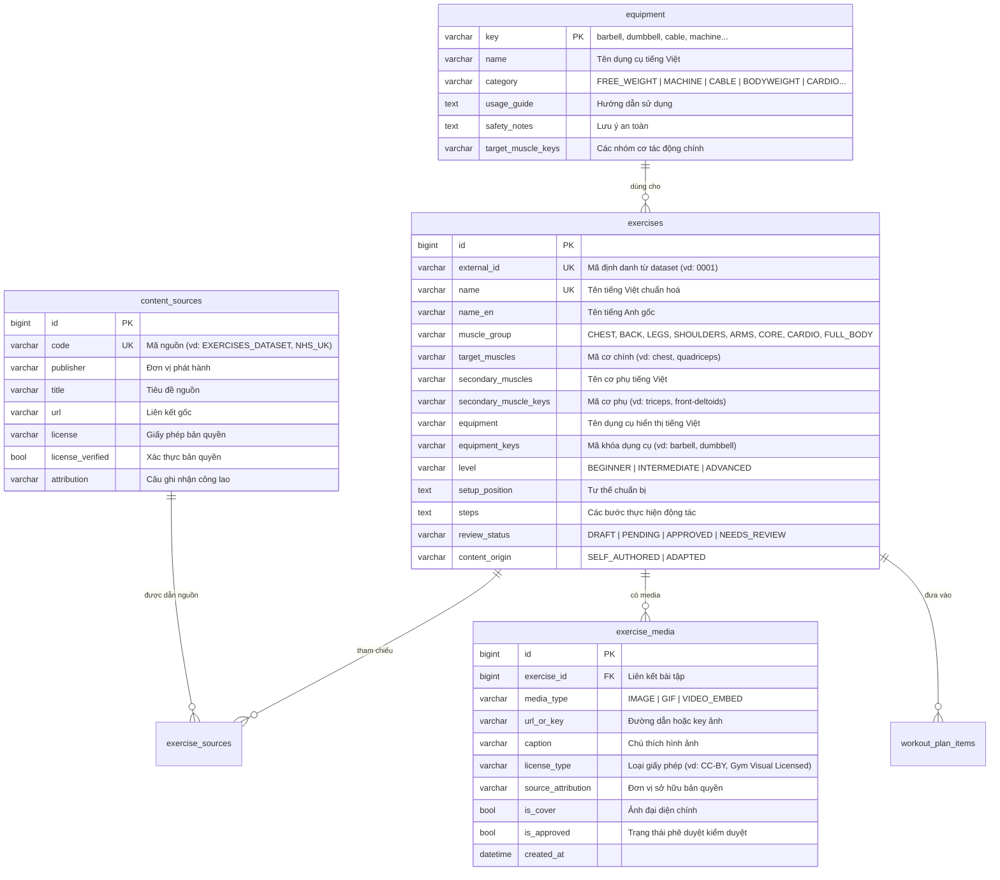

# BÁO CÁO KHẢO SÁT & THIẾT KẾ KIẾN TRÚC: KHO KIẾN THỨC FITNESS (GIAI ĐOẠN A)

**Dự án:** GymFlow — Nâng cấp Thư viện Bài tập, Thiết bị và Kho Kiến thức Thể thao  
**Phiên bản:** 1.0.0 (Giai đoạn A: Khảo sát & Thiết kế)  
**Nhánh Git:** `feat/nang-cap-kho-kien-thuc-fitness`  

---

## 1. Khảo sát hiện trạng thư viện bài tập (`/exercises`) & các thành phần liên quan

### 1.1. Giao diện người dùng & Route Frontend
Trước khi nâng cấp, phân hệ quản lý bài tập và kiến thức thể thao trong GymFlow bao gồm các route chính:
* **`/exercises` (`Exercises.tsx`)**:
  - Giao diện dạng thẻ đơn giản hiển thị danh sách bài tập.
  - Phân loại lọc cơ bản theo nhóm cơ (`CHEST`, `BACK`, `LEGS`, `SHOULDERS`, `ARMS`, `CORE`, `CARDIO`, `FULL_BODY`) và mức độ (`BEGINNER`, `INTERMEDIATE`, `ADVANCED`).
  - Hạn chế: Chưa có tính năng chuyển đổi chế độ xem Grid (lưới thẻ) / List (danh sách bảng); tìm kiếm chưa có gợi ý nhanh (autocomplete drop-down); chưa có bộ lọc phân quyền kiểm duyệt (Member chỉ được xem bài đã duyệt `APPROVED`, Trainer/Admin xem cả bài `PENDING`/`DRAFT`).
* **`/exercises/:id` (`ExerciseDetail.tsx`)**:
  - Trang chi tiết hiển thị tên bài, hình ảnh minh hoạ, hướng dẫn các bước, cơ bắp tác động và nguồn tham chiếu y tế.
  - Hạn chế: Nếu bài tập thiếu hình ảnh minh hoạ thì bị vỡ giao diện hoặc hiển thị khung trống; thiếu bản đồ giải phẫu trung tính (`MuscleMap`); thiếu nút tương tác tiện lợi cho Member (như "Thêm vào lịch tập cá nhân", "Đưa vào giáo án"); Trainer/Admin chưa có nút duyệt nhanh (Approve / Request Revision) trực tiếp trên trang chi tiết.
* **`/equipment` (`Equipment.tsx`)**:
  - Quản lý danh mục dụng cụ/thiết bị phòng gym (`barbell`, `dumbbell`, `cable`, `machine`...).
  - Hạn chế: Chưa có thanh tìm kiếm thiết bị nhanh theo tên tiếng Anh / tiếng Việt; chưa có bộ lọc phân loại dụng cụ (Tạ tự do, Máy tập, Dây cáp, Thiết bị Cardio, Phục hồi); chưa thể bấm vào nhóm cơ mục tiêu để nhảy trực tiếp sang danh sách bài tập tương ứng.

### 1.2. Cơ sở dữ liệu hiện có (Database Schema)
Các bảng dữ liệu liên quan trong hệ thống GymFlow hiện tại:
* **`exercises`**: Bảng chứa thông tin cốt lõi bài tập (`name`, `name_en`, `muscle_group`, `equipment`, `level`, `instructions`, `steps`, `target_muscles`, `secondary_muscle_keys`, `review_status`, `content_origin`...).
* **`equipment`**: Bảng lưu trữ 17+ loại dụng cụ phòng tập chuẩn hóa (`key`, `name`, `category`, `usage_guide`, `safety_notes`, `target_muscle_keys`...).
* **`exercise_alternatives`**: Bảng liên kết các bài tập thay thế tương đương (`exercise_id`, `alternative_id`).
* **`content_sources` & `exercise_sources`**: Bảng lưu trữ nguồn trích dẫn y tế/khoa học thể thao (NHS, OGL v3.0, ACE Fitness...), xác thực tính hợp pháp của bản quyền (`license_verified`).
* **`articles`**: Bảng lưu trữ kho bài viết kiến thức thể thao, dinh dưỡng, hồi phục (`slug`, `category`, `status`, `review_note`...).
* **`workout_plans` & `workout_plan_items`**: Bảng giáo án luyện tập của Hội viên / HLV, liên kết với các bài tập trong `exercises`.

### 1.3. Các Endpoint API Backend hiện có
* `GET /api/exercises`: Lấy danh sách bài tập (hỗ trợ phân trang, tìm kiếm không dấu, lọc theo nhóm cơ, thiết bị, trạng thái kiểm duyệt).
* `GET /api/exercises/{id}`: Chi tiết một bài tập kèm danh sách nguồn trích dẫn và bài tập thay thế.
* `POST /api/exercises` & `PUT /api/exercises/{id}`: Thêm mới/chỉnh sửa bài tập (dành cho Trainer/Admin).
* `PATCH /api/admin/exercises/{id}/review`: Quyền Admin phê duyệt bài tập (`APPROVED`, `NEEDS_REVIEW`).
* `GET /api/equipment` & `GET /api/equipment/{key}`: Danh mục thiết bị phòng gym và danh sách bài tập liên quan.

---

## 2. Đánh giá pháp lý & Bản quyền của 2 Nguồn Tham Khảo

### 2.1. Nguồn `hasaneyldrm/exercises-dataset` (1.324 bài tập)
* **Quy mô & Cấu trúc dữ liệu**:
  - Gồm file dữ liệu gốc `data/exercises.json` chứa **1.324 bài tập** đầy đủ cấu trúc metadata: `id`, `name`, `bodyPart`, `equipment`, `target`, `secondaryMuscles`, `instructions`.
  - Có file schema kiểm tra tính hợp lệ `data/exercises.schema.json`.
* **Phân tích Bản quyền & Giấy phép (License Review)**:
  - Repository được cấp phép theo **MIT License** cho phần mã nguồn, dữ liệu metadata văn bản và các bước hướng dẫn kỹ thuật.
  - **CẢNH BÁO PHÁP LÝ QUAN TRỌNG VỀ MEDIA**: Toàn bộ hình ảnh minh hoạ (`images/`) và ảnh động GIF (`gifs/`) trong repository này thuộc quyền sở hữu trí tuệ độc quyền của **Gym Visual**. Theo tuyên bố bản quyền của tác giả dataset, các tài sản trực quan này chỉ được phép phân phối kèm trong kho lưu trữ của họ; bất kỳ bên thứ ba nào muốn sử dụng hình ảnh/GIF này cho mục đích ứng dụng sản phẩm hoặc thương mại đều bắt buộc phải mua bản quyền trực tiếp từ Gym Visual.
* **Nguyên tắc triển khai tuân thủ tại GymFlow**:
  1. **ĐƯỢC PHÉP NHẬP**: Toàn bộ dữ liệu văn bản metadata (`name`, `bodyPart`, `equipment`, `target`, `secondaryMuscles`, `instructions`) theo giấy phép MIT.
  2. **TUYỆT ĐỐI KHÔNG NHẬP ẢNH/GIF**: Không lưu bất kỳ tệp ảnh/GIF nào của Gym Visual vào repository, Docker image hay database production; **tuyệt đối không dùng kỹ thuật hotlink** liên kết trực tiếp tới URL của tác giả.
  3. **GIẢI PHÁP GIAO DIỆN**: Khi chưa có giấy phép media thương mại, toàn bộ giao diện bài tập sử dụng **Placeholder trung tính** là Bản đồ giải phẫu cơ thể tương tác vector SVG (`MuscleMap`) được tô sáng vùng cơ mục tiêu chuẩn xác.
  4. **GHI NHẬN NGUỒN CHUẨN MỰC**: Bổ sung bản ghi `EXERCISES_DATASET` vào bảng `content_sources` với đầy đủ liên kết giấy phép MIT và câu trích dẫn ghi công (Attribution).
  5. **QUY TRÌNH DUYỆT BẢN DỊCH**: Vì dataset gốc hoàn toàn bằng tiếng Anh và chưa có phân loại cấp độ khó (`level`), bản dịch tiếng Việt và độ khó được hệ thống chuẩn hoá tự động và bắt buộc lưu ở trạng thái **Chờ duyệt (`PENDING`)**, chỉ hiển thị cho Hội viên sau khi Trainer/Admin xác nhận.

### 2.2. Nguồn `workoutfree/workout-home` (Khoảng 10.000 thư mục SEO)
* **Phân tích Bản quyền & Chất lượng dữ liệu**:
  - Repository **hoàn toàn KHÔNG có file LICENSE** và **KHÔNG có file README.md**.
  - Nội dung gồm hàng chục nghìn thư mục được tạo tự động nhắm vào từ khóa công cụ tìm kiếm (SEO-spam), không có thẩm định chuyên môn về y học thể thao.
* **Nguyên tắc triển khai tuân thủ tại GymFlow**:
  1. **TUYỆT ĐỐI KHÔNG SAO CHÉP HOẶC NHẬP DỮ LIỆU**: Không copy bất kỳ bài viết, đoạn văn hay file dữ liệu nào từ nguồn này vào hệ thống GymFlow để tránh vi phạm bản quyền và rủi ro pháp lý.
  2. **CHỈ THAM KHẢO CHỦ ĐỀ**: Chỉ tham khảo danh sách các chủ đề tập luyện tại nhà thông dụng (ví dụ: Calisthenics, Tabata, Giãn cơ tại bàn làm việc) để đội ngũ GymFlow tự biên soạn nội dung mới độc lập (**`SELF_AUTHORED`**).
  3. Mọi bài viết mới trong bảng `articles` do hệ thống tự sinh đều ở trạng thái nháp (`DRAFT` / `PENDING`), có trích dẫn tuyên bố miễn trừ y tế (`HealthDisclaimer`).

---

## 3. Thiết kế Cơ sở Dữ liệu Mới (Schema Upgrade Proposal)

Để tích hợp an toàn 1.324 bài tập, quản lý bản quyền media và đồng bộ dữ liệu độc lập (idempotent), hệ thống bổ sung lược đồ CSDL thông qua migration version kế tiếp (**`V22__fitness_knowledge_upgrade.sql`**):

### Chi tiết các thay đổi CSDL:
1. **Cột `exercises.external_id` (VARCHAR 40, Indexed)**:
   - Lưu trữ mã ID gốc từ dataset (ví dụ: `"0001"`, `"0002"`, `"0025"`...).
   - Đảm bảo tính **Idempotent**: Khi chạy lại script import nhiều lần, hệ thống sẽ đối chiếu `external_id` (hoặc `name_en`), nếu bài tập đã tồn tại thì chỉ cập nhật trường còn thiếu chứ không tạo trùng lặp bản ghi.
2. **Bảng `exercise_media`**:
   - Quản lý tách bạch các phương tiện truyền thông (ảnh chụp thật, GIF minh hoạ, video Youtube embed) kèm theo loại giấy phép bản quyền (`license_type`) và nguồn ghi công (`source_attribution`).
   - Cờ `is_approved` bảo đảm chỉ media được Admin/Trainer kiểm duyệt bản quyền hợp pháp mới được hiển thị cho người dùng cuối.
3. **Bản ghi Nguồn tham khảo `content_sources` (`EXERCISES_DATASET`)**:
   - Cung cấp tính minh bạch khoa học và tuân thủ yêu cầu của giấy phép MIT License.

---

## 4. Bảng Ánh Xạ Thuộc Tính (Field Mapping Table)

Bảng đối chiếu quy tắc chuyển đổi giữa các thuộc tính trong JSON dataset gốc sang các cột CSDL GymFlow:

| Trường Dataset (`exercises.json`) | Kiểu dữ liệu gốc | Cột Đích GymFlow (`exercises`) | Quy tắc chuyển đổi & Xử lý nghiệp vụ |
| :--- | :--- | :--- | :--- |
| `id` | `String` (vd: `"0001"`) | `external_id` | Lưu nguyên vẹn ID gốc, tạo index `ix_ex_external_id` phục vụ kiểm tra trùng lặp idempotent. |
| `name` | `String` (vd: `"3/4 sit-up"`) | `name_en` | Chuyển đổi thành Title Case (vd: `"3/4 Sit-Up"`). |
| `name` | `String` | `name` (Tiếng Việt) | Dịch sang tiếng Việt kết hợp tên động tác + nhóm cơ + dụng cụ. Đảm bảo ràng buộc `UNIQUE`: nếu trùng tên thì tự động thêm hậu tố ` #" + externalId`. |
| `bodyPart` | `String` (vd: `"waist"`, `"chest"`) | `muscle_group` | Ánh xạ sang enum `MuscleGroup`: `waist` $\rightarrow$ `CORE`, `chest` $\rightarrow$ `CHEST`, `back` $\rightarrow$ `BACK`, `upper legs` $\rightarrow$ `LEGS`, `lower arms` $\rightarrow$ `ARMS`... |
| `target` | `String` (vd: `"pectorals"`) | `target_muscles` | Chuẩn hoá thành mã cơ SVG: `pectorals` $\rightarrow$ `"chest"`, `quads` $\rightarrow$ `"quadriceps"`, `lats` $\rightarrow$ `"upper-back"`, `spine` $\rightarrow$ `"lower-back"`... |
| `secondaryMuscles` | `List<String>` | `secondary_muscles` | Dịch danh sách các cơ hỗ trợ sang tiếng Việt hiển thị cách nhau bằng dấu phẩy. |
| `secondaryMuscles` | `List<String>` | `secondary_muscle_keys` | Chuẩn hoá thành danh sách mã anatomy SVG tương ứng. |
| `equipment` | `String` (vd: `"barbell"`, `"body weight"`) | `equipment_keys` | Ánh xạ sang mã key chuẩn trong bảng `equipment`: `"body weight"` $\rightarrow$ `"bodyweight"`, `"dumbbell"` $\rightarrow$ `"dumbbell"`, `"ez barbell"` $\rightarrow$ `"ez-bar"`... |
| `equipment` | `String` | `equipment` | Tên dụng cụ tiếng Việt chuẩn hoá (vd: `"Thanh đòn (Barbell)"`, `"Tạ đơn (Dumbbell)"`). |
| `instructions` | `List<String>` | `steps` | Ghép danh sách các bước thành chuỗi đánh số thứ tự: `"1. ... \n2. ... \n3. ..."`. |
| `instructions` | `List<String>` | `instructions` | Lưu trữ văn bản hướng dẫn tổng quan. |
| *(Tự động xác định)* | N/A | `location` | Nếu dụng cụ là `bodyweight` hoặc `band` $\rightarrow$ `ANY` hoặc `HOME`; nếu là máy khối, cáp hoặc thanh đòn $\rightarrow$ `GYM`. |
| *(Tự động xác định)* | N/A | `level` | Mặc định `BEGINNER` cho các bài bodyweight/cơ bản, `INTERMEDIATE` cho bài tạ tự do, `ADVANCED` cho bài đa khớp kỹ thuật cao. |
| *(Tự động xác định)* | N/A | `review_status` | Luôn đặt mặc định là **`PENDING`** (chờ Admin/Trainer kiểm duyệt nội dung trước khi công khai cho Member). |
| *(Tự động xác định)* | N/A | `content_origin` | Đặt giá trị **`ADAPTED`** (biên soạn từ nguồn dữ liệu mở, tuân thủ quy chuẩn). |

---

## 5. Từ Điển Chuẩn Hoá Tên Nhóm Cơ & Thiết Bị (Anh – Việt)

### 5.1. Bảng 10 Nhóm Cơ Chính (Body Parts $\rightarrow$ MuscleGroup Enum)
| Tiếng Anh (`bodyPart`) | Nhóm Cơ GymFlow (`MuscleGroup`) | Tên Tiếng Việt Hiển Thị | Vùng Cơ Đại Diện |
| :--- | :--- | :--- | :--- |
| `chest` | `CHEST` | Cơ Ngực | Ngực trên, ngực giữa, ngực dưới |
| `back` | `BACK` | Cơ Lưng - Xô | Lưng trên, cơ xô (lats), lưng dưới, cầu vai |
| `upper legs`, `lower legs` | `LEGS` | Cơ Đùi & Bắp Chân | Đùi trước (quads), đùi sau (hamstrings), bắp chân |
| `shoulders`, `neck` | `SHOULDERS` | Cơ Vai | Vai trước, vai giữa, vai sau, cơ cổ |
| `upper arms`, `lower arms` | `ARMS` | Cơ Tay | Tay trước (biceps), tay sau (triceps), cẳng tay |
| `waist` | `CORE` | Cơ Bụng & Liên Sườn | Cơ bụng 6 múi (abs), liên sườn (obliques), cơ lõi sâu |
| `cardio` | `CARDIO` | Tim Mạch & Sức Bền | Hệ tuần hoàn, sức bền toàn thân |
| *toàn thân* | `FULL_BODY` | Toàn Thân | Phối hợp đa khớp toàn bộ cơ thể |

### 5.2. Danh Sách 25+ Vùng Cơ Giải Phẫu Chi Tiết (Anatomy Target & Secondary Keys)
| Target Key (SVG) | Thuật Ngữ Gốc Dataset | Tên Tiếng Việt Chuẩn Hoá | Vị Trí & Tác Dụng |
| :--- | :--- | :--- | :--- |
| `chest` | pectorals | Cơ ngực lớn | Đẩy ngực, khép tay qua ngực |
| `upper-back` | lats, upper back | Cơ xô & lưng trên | Kéo tạ, kéo xà, phát triển độ rộng lưng |
| `lower-back` | spine, lower back | Cơ lưng dưới | Nâng đỡ cột sống, deadlift, tư thế hip-hinge |
| `trapezius` | traps, levator scapulae | Cơ cầu vai & cổ | Nhún vai, ổn định bả vai |
| `front-deltoids` | delts (anterior) | Cơ vai trước | Nâng tay về phía trước, đẩy vai qua đầu |
| `back-deltoids` | delts (posterior) | Cơ vai sau | Kéo mặt (face pull), dang tay ngược |
| `biceps` | biceps | Cơ tay trước (Bắp tay) | Gập khuỷu tay, cuốn tạ |
| `triceps` | triceps | Cơ tay sau | Duỗi khuỷu tay, đẩy tạ hẹp tay |
| `forearm` | forearms | Cơ cẳng tay & cổ tay | Lực cầm nắm (grip strength), cuộn cổ tay |
| `abs` | abs, rectus abdominis | Cơ bụng | Gập bụng, ổn định thân trên |
| `obliques` | serratus anterior, obliques | Cơ liên sườn | Xoay người, nghiêng thân, bảo vệ cột sống |
| `quadriceps` | quads | Cơ đùi trước | Duỗi khớp gối, ngồi xổm (squat), đạp đùi |
| `hamstring` | hamstrings | Cơ đùi sau | Gập gối, ngả hông về sau (Romanian deadlift) |
| `gluteal` | glutes | Cơ mông | Duỗi hông, phát lực đẩy hông (hip thrust) |
| `adductor` | adductors | Cơ đùi trong | Khép đùi vào trong, ổn định khớp háng |
| `abductors` | abductors | Cơ hông ngoài | Mở đùi ra ngoài, giữ thăng bằng một chân |
| `calves` | calves | Cơ bắp chân | Nhón gót chân, bật nhảy |

### 5.3. Danh Sách 20+ Dụng Cụ & Thiết Bị Phòng Tập (Equipment Keys)
| Key Dụng Cụ | Tên Tiếng Việt Chuẩn Hoá | Phân Loại (`category`) | Mô Tả & Lưu Ý Sử Dụng |
| :--- | :--- | :--- | :--- |
| `bodyweight` | Trọng lượng cơ thể (Không dụng cụ) | `BODYWEIGHT` | Dùng chính sức nặng bản thân; phù hợp mọi nơi. |
| `barbell` | Thanh đòn tiêu chuẩn (Barbell) | `FREE_WEIGHT` | Dùng cho Squat, Bench Press, Deadlift; cần kẹp khóa tạ. |
| `dumbbell` | Tạ đơn (Dumbbell) | `FREE_WEIGHT` | Tạ tay cầm độc lập; tối ưu biên độ chuyển động. |
| `kettlebell` | Tạ ấm (Kettlebell) | `FREE_WEIGHT` | Tạ quai hình chuông; phát lực quán tính hông (swing). |
| `ez-bar` | Thanh đòn ziczac EZ | `FREE_WEIGHT` | Thanh cong chữ W; bảo vệ cổ tay khi cuốn tay trước. |
| `plate` | Bánh tạ (Weight Plate) | `FREE_WEIGHT` | Bánh tạ rời lắp đòn hoặc ôm tập gập bụng, xoay người. |
| `cable` | Máy kéo cáp (Cable) | `CABLE` | Duy trì lực căng liên tục trên toàn bộ quỹ đạo động tác. |
| `machine` | Máy tập khối tạ cố định | `MACHINE` | Định hướng quỹ đạo an toàn; rất tốt cho người mới. |
| `smith-machine` | Máy Smith | `MACHINE` | Thanh đòn trượt ray dọc có chốt cài an toàn cơ học. |
| `band` | Dây kháng lực (Resistance Bands) | `ACCESSORY` | Dây cao su đàn hồi kích hoạt cơ, khởi động và hỗ trợ kéo xà. |
| `ball` | Bóng tập thăng bằng (Exercise Ball) | `ACCESSORY` | Rèn luyện cân bằng, kích hoạt cơ lõi (core). |
| `foam-roller` | Con lăn bọt giãn cơ (Foam Roller) | `RECOVERY` | Tự giải phóng mạc cơ (SMR), thư giãn điểm căng cứng sau tập. |
| `pullup-bar` | Xà đơn (Pull-up Bar) | `BODYWEIGHT` | Hít xà phát triển toàn diện cơ xô và tay trước. |
| `dip-bars` | Xà kép (Dip Station) | `BODYWEIGHT` | Chống xà kép phát triển cơ ngực dưới và tay sau. |
| `cardio-machine` | Máy tập Cardio (Treadmill, Bike, Rower) | `CARDIO` | Máy chạy bộ, xe đạp, máy chèo thuyền rèn luyện tim mạch. |
| `bench` | Ghế tập thể hình (Bench) | `ACCESSORY` | Ghế phẳng, dốc lên hoặc dốc xuống hỗ trợ tập tạ. |

---

## 6. Kế hoạch Thực hiện Tiếp theo

| Giai đoạn | Nội dung công việc | Trạng thái kỹ thuật |
| :--- | :--- | :--- |
| **Giai đoạn A** | Báo cáo hiện trạng, đánh giá bản quyền, thiết kế schema CSDL, từ điển chuẩn hoá Anh - Việt | **ĐÃ HOÀN TẤT** (Báo cáo này) |
| **Giai đoạn B** | Flyway migration `V22`, seed dữ liệu mở an toàn (loại bỏ visual assets), `ExerciseImporterService` (dry-run, idempotent), `POST /api/admin/exercises/import` | Sẵn sàng triển khai & nghiệm thu |
| **Giai đoạn C** | Redesign giao diện `/exercises` (autocomplete, toggle grid/list), `/exercises/:id` (neutral anatomy hero, health disclaimer), `/equipment` | Sẵn sàng triển khai & nghiệm thu |
| **Giai đoạn D** | Đồng bộ giáo án mẫu bilingual, quy trình duyệt nội dung Trainer/Admin, kiểm soát an toàn | Sẵn sàng triển khai & nghiệm thu |
| **Giai đoạn E** | Tích hợp lịch tập (`/schedules?exerciseId=...`), Chatbot AI tư vấn bài tập, thiết bị, an toàn phòng tập | Sẵn sàng triển khai & nghiệm thu |
